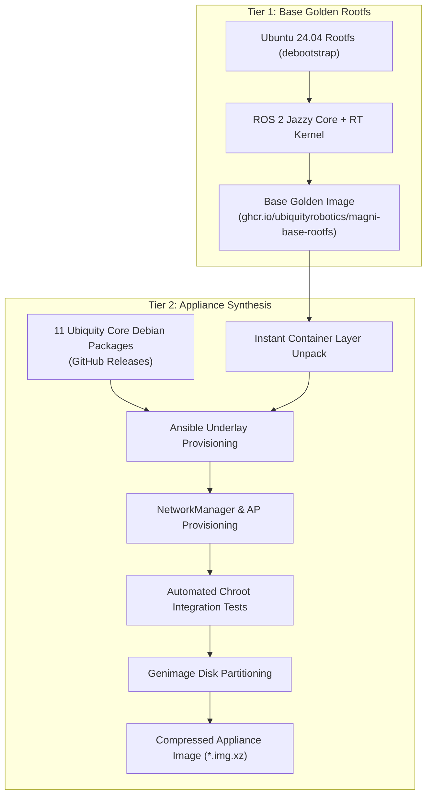

# Ubiquity Robotics Raspberry Pi Appliance Image Generator (`rpi-image-gen`)

Production OS image generator for Ubiquity Robotics Magni and custom autonomous mobile robot platforms, running **Ubuntu 24.04 LTS (Noble Numbat)** and **ROS 2 Jazzy Jalisco**.

---

## 1. Architecture Overview

`rpi-image-gen` uses a **Two-Tier Golden Rootfs Pipeline** to deliver deterministic, rapid image synthesis:



### The Two Tiers Explained:
1. **Tier 1 (Base Golden Rootfs):**
   * Encapsulates heavy, stable dependencies: Ubuntu 24.04 base system, real-time Linux kernel, ROS 2 Jazzy base, compiler toolchains (`clang`, `ccache`, `ninja`), and system libraries.
   * Built once and distributed as an OCI container image artifact (`ghcr.io/ubiquityrobotics/magni-base-rootfs:noble-jazzy`).
2. **Tier 2 (Appliance Synthesis):**
   * Unpacks the base golden rootfs in seconds without re-running debootstrap or APT package resolution.
   * Ingests the 11 Ubiquity Core Debian packages from GitHub Releases and installs them into `/opt/ros/jazzy`.
   * Executes the Ansible playbook to configure systemd units, dynamic MAC-based hostname provisioning, Wi-Fi AP hotspot, and real-time scheduling rules.
   * Partitions the raw ext4 rootfs and boot partition using `genimage` into a flashable `.img.xz`.

---

## 2. Target Hardware Profiles

| Target Platform | Configuration File | Supported Peripherals |
| :--- | :--- | :--- |
| **Raspberry Pi 5** | `config/ubuntu24-ros2-pi5.cfg` | UART Pinmux (RP1), IMX219 / IMX708 Picam (libcamera v0.7.2), LD19 / LS-C1 LiDAR, Micro-ROS / micro-MCB G6 |
| **Raspberry Pi 4** | `config/ubuntu24-ros2-pi4.cfg` | PL011 UART (/dev/ttyAMA0), MCB Gen5 motor controller, Pi Sonar, OLED display |

---

## 3. The 11 Core Ubiquity Appliance Debian Packages

During Tier 2 synthesis, the pipeline downloads and installs 11 modular Debian packages into `/opt/ros/jazzy`:

| Package Name | Upstream Repository | Purpose |
| :--- | :--- | :--- |
| `ros-jazzy-robot-bringup` | `UbiquityRobotics/robot_bringup` | Top-level hardware, navigation, and teleop launch orchestration |
| `ros-jazzy-magni-description` | `UbiquityRobotics/magni_robot` | URDF robot kinematic models, extrinsics, and TF static trees |
| `ros-jazzy-ubiquity-core-utils` | `UbiquityRobotics/ubiquity_core_utils` | Odom TF broadcasting, cmd_vel bridging, and diagnostic helpers |
| `ezmap-web` | `UbiquityRobotics/ezmap` | Static Svelte 5 Web HMI and Nginx reverse proxy configuration |
| `ros-jazzy-ezmap` | `UbiquityRobotics/ezmap` | Unified ROS 2 backend services (`ezmap_node`), map manager, and IDL interfaces |
| `ros-jazzy-move-smooth` | `UbiquityRobotics/move_smooth` | Continuous-curvature Bézier trajectory planner and obstacle avoidance controller |
| `ros-jazzy-ubiquity-route-manager`| `UbiquityRobotics/ubiquity_route_manager` | Route sequencing, executor node, waypoint triggers, and actions |
| `ros-jazzy-fiducials` | `UbiquityRobotics/fiducials` | High-precision STag / ArUco visual marker detection and localization |
| `ros-jazzy-ubiquity-motor-ros2` | `UbiquityRobotics/ubiquity_motor_ros2` | MCB motor driver and `ros2_control` diff-drive controller manager |
| `ros-jazzy-lidar-ros2` | `UbiquityRobotics/lidar_ros2` | LD06 / LD19 and Leishen LS-C1 / LS-N10 serial LiDAR drivers |
| `ros-jazzy-iris-lama-ros` | `UbiquityRobotics/iris_ur_lama_ros` | Fast 2D grid mapping and hybrid particle filter SLAM |

---

## 4. Building the Image

### Method A: Automated Cloud Build (GitHub Actions)
The recommended way to generate official images is via GitHub Actions:
1. Navigate to **Actions** &rarr; **Synthesize Appliance Image**.
2. Select your target configuration (`config/ubuntu24-ros2-pi5.cfg` or `config/ubuntu24-ros2-pi4.cfg`).
3. Click **Run workflow**. The runner will validate credentials, download the latest release debs, assemble the rootfs, run automated integration tests, and output a compressed `.img.xz` artifact.

### Method B: Fast Local Synthesis (Linux / ARM64 or x86_64 with QEMU)
To synthesize an appliance image locally from the cached base rootfs:

```bash
# 1. Ensure prerequisites are installed
sudo apt-get install -y genimage xz-utils curl jq gh ansible podman

# 2. Run the fast synthesis script
./scripts/synthesize_fast_appliance.sh \
  --config config/ubuntu24-ros2-pi5.cfg \
  --options credentials24
```

#### Synthesis Script Options:
* `-c, --config <file>`: Hardware profile configuration (Default: `config/ubuntu24-ros2-pi5.cfg`).
* `-o, --options <file>`: Build options file (Default: `credentials24`).
* `--debs-dir <dir>`: Directory containing pre-downloaded `.deb` packages (Default: `ansible/roles/ros2_workspace/files/debs`).
* `--base-image <tag>`: OCI container tag for base rootfs (Default: `ghcr.io/ubiquityrobotics/magni-base-rootfs:noble-jazzy`).
* `--skip-tests`: Skip automated chroot verification test suite.

---

## 5. Flashing to SD Card / NVMe

1. Decompress the synthesized image (if `.xz` compressed):
   ```bash
   unxz -k ubiquity-noble-jazzy-pi5.img.xz
   ```
2. Flash to your target storage device using **Raspberry Pi Imager** or `dd`:
   ```bash
   sudo dd if=ubiquity-noble-jazzy-pi5.img of=/dev/sdX bs=4M status=progress conv=fsync
   ```

---

## 6. First Boot & Getting Started

### Default Credentials
* **Username:** `ubuntu`
* **Password:** `ubuntu`

### Network Connectivity on First Boot
1. **Dynamic MAC-Based Hostname:**
   The robot dynamically inspects its wireless MAC address on first boot and sets its hostname to:
   `ubiquityrobotXXXX` (where `XXXX` are the last 4 characters of `wlan0` MAC address).
2. **Automatic Wi-Fi Hotspot (Access Point):**
   If no known Wi-Fi network is detected, the robot automatically broadcasts a hotspot:
   * **SSID:** `ubiquityrobotXXXX`
   * **Password:** `robotseverywhere`
   * **Robot Gateway IP:** `192.168.0.1`
3. **Wired Ethernet (Direct Cable):**
   * **Static IP:** `192.168.42.125/24` (Interface: `end0`)
   * Workstation configuration: Set your PC wired Ethernet adapter to `192.168.42.100`, Netmask `255.255.255.0`.

### Step-by-Step Connection Guide

#### 1. Connect via SSH
Connect your computer to the `ubiquityrobotXXXX` Wi-Fi hotspot and run:
```bash
ssh ubuntu@192.168.0.1
# Password: ubuntu
```

#### 2. Access the Web Console (EZ-Map & Telemetry)
While connected to the Access Point, open your browser:
```text
http://192.168.0.1/
```
The web console provides interactive SLAM mapping, route scheduling, virtual teleoperation, and live diagnostics streaming over Foxglove bridge.

#### 3. Connect the Robot to Local Wi-Fi
Using NetworkManager CLI (`nmcli`):
```bash
# Scan available Wi-Fi networks
sudo nmcli dev wifi list

# Connect to your local Wi-Fi
sudo nmcli dev wifi connect "MyHomeNetwork" password "MyPassword"
```
*Note: Once connected to your local network, the Access Point will shut down, and your SSH session to `192.168.0.1` will close. Reconnect using mDNS or the assigned router IP:*
```bash
ssh ubuntu@ubiquityrobotXXXX.local
# or
ssh ubuntu@<Assigned_IP>
```

---

## 7. Verifying Robot Runtime & Services

All core robot subsystems run automatically via `systemd` and communicate over Zenoh (`rmw_zenoh_cpp`):

```bash
# Inspect all Magni systemd services
systemctl list-units 'magni*' 'rmw*' --no-pager
```

### Core Services:
* `rmw_zenohd.service` - Embedded Zenoh router daemon
* `magni-hardware.service` - Hardware drivers, encoders, and motor controllers
* `magni-teleop.service` - Twist multiplexer and teleoperation joystick input
* `magni-navigation.service` - SLAM (Iris LAMA), Move Smooth trajectory follower, Route Manager
* `magni-ui.service` - EZ-Map backend and Foxglove WebSocket bridge (Port 8765)
* `magni-diagnostics.service` - Diagnostic aggregator

### Checking ROS 2 Nodes:
Every interactive and remote SSH shell has the ROS 2 environment loaded automatically:
```bash
ros2 node list
```

Expected active nodes:
```text
/actions_node
/diagnostics_agg
/ezmap_node
/foxglove_bridge
/iris_lama_ros
/move_smooth
/odom_tf_broadcaster
/robot_state_publisher
/route_executor_node
/route_setup_node
/stag_detect
/triggers_node
/twist_mux
```

---

## 8. Development & Maintenance

### Working with the Customer Overlay Workspace
The robot includes a ready-to-use ROS 2 workspace at `/home/ubuntu/ros2_ws`:
```bash
cd /home/ubuntu/ros2_ws
colcon build --symlink-install
source install/setup.bash
```

### License & Support
* **License:** BSD-3-Clause / Apache-2.0
* **Support:** [Ubiquity Robotics Support](https://ubiquityrobotics.com/)
